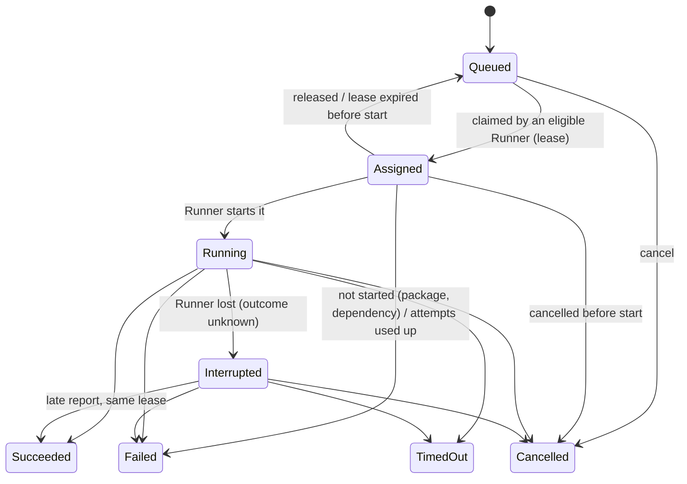

# Orchestrator, Runners and operations (Phase 10)

The decisions are in ADR-0049 (orchestrator, packages, Runner, protocol), ADR-0050 (SQLite store) and ADR-0051 (roles,
tokens, Runner listener). The slices are in [orchestrator-plan.md](orchestrator-plan.md).

```
Web Studio ──(session cookie, loopback)──┐
Tools ──(access token)───────────────────┤
                                         ▼
                 MyRPA.Server (control plane)
                 ├─ /api/orchestrator/*  Orchestrator (MyRPA.Orchestration)
                 ├─ /runner/v1/*         Runner protocol
                 └─ SQLite store         <data>/orchestration.db
                                         ▲
     outbound HTTPS, Runner token ───────┘
Runner A (myrpa-runner)          Runner B (myrpa-runner)
engine + plugins + ExecutionHost engine + plugins + ExecutionHost
```

- **The Server decides what runs, when and where.** It publishes, queues, schedules, dispatches and records. It never
  executes a published job; the Studio's local Run and Debug remain the development path.
- **The Runner executes.** It runs the same engine, built-in activities, plugin host and `ExecutionHost` as the CLI and
  the Server.

## Concepts

| Term | Meaning |
|---|---|
| Process | A project, published as numbered versions (one process per project). |
| Entry point | A workflow of a version that a job may start, chosen when publishing. Publishing one workflow is a project with a single entry point. Jobs and schedules name their entry point; it may be left out while the version has only one. |
| Version (package) | An immutable snapshot (`myrpa-package/2`). It holds the project's valid workflow files and a manifest: file hashes, package SHA-256, activity types, the plugins (id and version) providing them, the entry points with their arguments, and who published it. Plugin binaries and settings are never in a package. |
| Deployment | The version a process's jobs and schedules use, plus its target (Runner group or Runner), default priority and time limit, and whether it is enabled. Rolling back means deploying an earlier version. |
| Job | One execution request for an exact version, with validated arguments. |
| Runner | A worker with its own token, group, concurrency cap and reported capabilities (plugins, activity types, OS). |
| Schedule | Once, Interval or Cron in a stated time zone, creating jobs for the deployed version. |

## Job states



**Guarantees:**
- **A job is accepted only once it is stored.** An idempotency key (`idempotencyKey` or the `Idempotency-Key` header)
  makes a repeated submission return the first job.
- **One job, one Runner at a time.** Claims are serialized and conditional on the job's revision.
- **Delivery is at least once.** A job that never started is requeued safely (up to `MaxAttempts` lease expiries, then
  `Failed`, `MYRPA5003`). A running job whose Runner stops reporting becomes `Interrupted` (`MYRPA5002`) and is never
  re-run automatically. An operator may Retry it, which creates a new job linked by `retryOfJobId`.
- **Duplicate and stale messages change nothing.** Completions are idempotent. Messages under an old lease, or from
  another Runner, get `LeaseValid: false`.
- **Events are stored at most once** per job, attempt and sequence. They are delivered at least once, so resends are
  harmless. A per-job cap (policy, default 20,000) counts what it drops.

**Cancellation is cooperative.** A queued job is cancelled at once. For an assigned or running job, the Server records
the request and the Runner hears it in its next heartbeat or event answer. The engine stops at the next activity
boundary; an external operation already in progress (an HTTP call, a running script) may finish first. The job becomes
`Cancelled` only when the Runner reports it.

## Runner protocol (`/runner/v1`, version 1)

Every request carries `Authorization: Bearer myrpa_runner_…` and `X-MyRPA-Runner-Protocol: 1` (and
`X-MyRPA-Correlation`). Bodies are JSON (`MyRPA.Contracts.Orchestration`).

| Call | Purpose |
|---|---|
| `POST register` | OS, architecture, machine, service mode, concurrency, plugins, activity types, plugin errors, held jobs. Held jobs the Runner no longer reports are requeued (not started) or interrupted (running). |
| `POST heartbeat` | Renews the leases of held jobs; answers `cancel`, `lost` and `paused`. Every 10 s by default. |
| `POST claim` | Long poll (`waitMs` up to 25,000). Answers 200 with a `JobAssignment` (job, lease, exact version, package hash, arguments, time limit, correlation id) or 204. |
| `GET jobs/{id}/package?lease=` | The package bytes, for the lease holder only. |
| `POST jobs/{id}/start` | Assigned → Running (or "cancelled before start"). |
| `POST jobs/{id}/events` | Up to 500 `ExecutionEventMessage`s; renews the lease; answers `cancelRequested`. |
| `POST jobs/{id}/complete` | The outcome: status, error, outputs (secret-fed outputs redacted), duration, execution id, `notStarted`. |
| `POST jobs/{id}/release` | Gives back a job that was not started (shutdown). |

Lease answers are 200 when the lease is valid and 409 when it is not, with the same JSON body. Runners retry network
errors, timeouts, 5xx, 408 and 429 with exponential backoff. A 401 means the token was refused: the Runner stops with
exit code 3.

## Management API (`/api/orchestrator`)

| Endpoint | Role |
|---|---|
| `GET me`, `overview?range=24h\|7d\|30d`, `jobs?state=&processId=&runnerId=&scheduleId=&offset=&limit=`, `jobs/{id}`, `jobs/{id}/events`, `processes`, `processes/{id}`, `processes/{id}/versions/{v}`, `schedules`, `schedules/preview`, `timezones`, `runners`, `runners/{id}`, `policy` | Viewer |
| `POST jobs` (submit), `jobs/{id}/cancel`, `jobs/{id}/retry`, `schedules/{id}/enabled` | Operator |
| `POST publish`, `processes/{id}/deploy`, `undeploy`, `enabled`, `settings`, `processes/{id}/schedules`; `PUT schedules/{id}`; `DELETE schedules/{id}` | Developer |
| `POST runners`, `PATCH runners/{id}`, `POST runners/{id}/revoke`, `runners/{id}/token`, `GET/POST tokens`, `POST tokens/{id}/revoke`, `PUT policy`, `GET audit`, `GET diagnostics` | Admin |

Job arguments and outputs appear in `jobs/{id}` for Operators and above only (`dataHidden` for Viewers). Token hashes
never appear.

Example: submit a job with an access token (on the Runner listener, or on loopback):

```bash
curl -H "Authorization: Bearer $MYRPA_TOKEN" -H "Content-Type: application/json" \
  -d '{"processId":"prc_…","argumentText":{"who":"Ada"},"idempotencyKey":"invoice-2026-10-12"}' \
  https://orchestrator.example:5311/api/orchestrator/jobs
```

## Schedules

- **Kinds:**
  - Once: at `startAt`;
  - Interval: every N minutes from `startAt`;
  - Cron: five fields, with names (`MON-FRI`, `JAN`), ranges, steps and lists. When both day fields are restricted,
    either matches.
- **Time zone:** each schedule has its own (IANA, e.g. `Europe/Amsterdam`, or a Windows id). Cron is read in that zone.
  A local time skipped by daylight saving fires once at the end of the gap; a repeated one fires once, at its first
  occurrence.
- **Exactly one job per fire time,** across repeated evaluation and Server restarts. The job's key is
  `schedule:<id>:<fire ticks>`, written in the same transaction as the schedule's next fire time.
- **Missed fire times** (more than 2 minutes late, e.g. the Server was stopped):
  - `RunOnce` (default) runs one job for the latest missed time;
  - `Skip` skips them.
- **Overlap:** `Skip` (default) skips a fire time while a job from the same schedule is still active; `Allow` starts
  another.
- **Disabled schedules or deployments** skip with a recorded reason. Enabling a schedule continues from now, without
  catching up.
- Event-based triggers are not part of Phase 10.

## Deploying

### Local development (one machine)

```bash
dotnet run --project src/MyRPA.Server -- --project samples          # data: %LOCALAPPDATA%\Laconi\Server
```

1. In the Studio, go to **Admin** and use **Create Runner**. Copy the token (it is shown once).
2. On the same machine, create `runner.json` next to a `runner.token` file:

   ```json
   { "serverUrl": "http://127.0.0.1:5310/", "tokenFile": "runner.token", "pluginConfig": "plugins.json", "maxConcurrency": 1 }
   ```

3. Start the Runner:

   ```bash
   dotnet run --project src/MyRPA.Runner -- check --config runner.json   # reachable, token accepted?
   dotnet run --project src/MyRPA.Runner -- run --config runner.json
   ```

### Remote Runners

- **Server:**

  ```bash
  set MYRPA_RUNNER_CERT_PASSWORD=…
  MyRPA.Server --projects-root D:\Projects --data D:\LaconiData --runner-url https://0.0.0.0:5311 --runner-cert D:\certs\orchestrator.pfx
  ```

  - The Runner listener needs https on any non-loopback address.
  - Open only that port in the firewall; the Studio listener stays loopback.
- **Runner machine:**
  - `runner.json` with `"serverUrl": "https://orchestrator.example:5311/"`. Add `"serverCertificateSha256": "<hex>"` only
    if the Server's certificate is self-signed; validation is never switched off.
  - **The token** goes in a file readable only by the Runner's account (or in the `MYRPA_RUNNER_TOKEN` environment
    variable, or the one named by `tokenEnvironmentVariable`). It is never put on the command line or in a package.
  - **`pluginConfig`** is the Runner's own plugin configuration (ADR-0019): browser, files, database, AI provider and
    `AI.Agent` with its MCP servers. Provider keys and MCP tokens stay in the Runner's environment variables.
- **Settings of `runner.json`:**
  - `serverUrl`, `tokenFile` or `tokenEnvironmentVariable`, `serverCertificateSha256`;
  - `pluginConfig`, `plugins` (directories);
  - `workDirectory` (default `work`; each job uses `work/jobs/<jobId>`, removed afterwards);
  - `maxConcurrency` (1–64), `claimWaitSeconds` (1–25), `shutdownGraceSeconds`.

  Relative paths resolve from the file. Unknown settings are refused.

### Windows service

`myrpa-runner` runs as a Windows service when the Service Control Manager starts it (service name `LaconiRunner`):

```powershell
sc.exe create LaconiRunner binPath= "\"C:\Laconi\Runner\myrpa-runner.exe\" run --config C:\Laconi\Runner\runner.json" start= delayed-auto
```

- **A service has no interactive desktop (session 0).** Headless browser automation, files, HTTP, databases, email,
  SFTP, scripting and AI work there. A visible browser, and desktop UI automation if it is added later, do not.
- **For desktop work,** run the Runner in a signed-in user session instead (for example started at logon) and give it
  its own group, so desktop jobs are dispatched only there. The Runner reports `service: true` when it runs as a
  service.
- Phase 10 does not claim or test desktop automation in a service session.

Linux and containers: the Runner is plain .NET 10 and runs headless (API, files, databases, headless browser). There
is no desktop UI support there.

## Studio pages

The rail shows these pages only when the Server runs the orchestrator:

| Page | What it does |
|---|---|
| **Deployments** | Publish the open project with the entry points ticked (saved files only; unsaved changes are not published); list processes with their state (Published, Deployed, Disabled); per process: versions with hash, files, plugins and notes; Deploy and Roll back; Enable, Disable, Undeploy; Run now for a chosen entry point with its typed arguments (secret-fed arguments cannot be set); schedules for an entry point with a preview of the next fire times; Runners eligible for the deployed version; recent executions. |
| **Monitoring** | Counts by state; an outcome trend (24 h, 7 d or 30 d); Runner availability; recent failures; the job list with state and workflow filters and paging; job details with attempts, errors, why a queued job waits, data (Operators and above), events (including `AI.Agent:` lines), Cancel and Retry. |
| **Robots** | Runners with status, workload, last heartbeat, machine, OS, service mode, plugins and activity types, and plugin errors. |
| **Admin** | Create, pause and resume, rotate tokens and revoke Runners; access tokens with roles; the execution policy; Server health and storage, Server plugins and the compatibility of deployed versions with Runners; the audit history. |

- **Every figure** comes from the API. Pages refresh every few seconds and show loading, empty and error states.
- **Actions** report the Server's answer. A button the role does not allow is disabled with the reason, and the Server
  refuses the action anyway.

## Troubleshooting

| Symptom | Cause and fix |
|---|---|
| Job stays Queued | Open it in Monitoring: "Why it waits" lists each Runner and what it lacks (activity, plugin version, group, revoked, paused, offline). |
| Job Failed `MYRPA5001` | The Runner lacks a plugin or activity the version needs; install it (same or newer version). |
| Job Failed `MYRPA5004` | The package failed its integrity check on the Runner; republish, and check for tampering or a proxy rewriting traffic. |
| Job Failed `MYRPA5003` | Assigned repeatedly but never started (the Runner crashed or lost the network before starting). |
| Job Interrupted `MYRPA5002` | The Runner stopped reporting while the job ran; its effects are unknown. Check the target system, then Retry if it is safe. |
| Runner exits with code 3 | Its token was refused (revoked, rotated or mistyped); issue a new token in Admin. |
| Runner says the Server is not reachable | Check `serverUrl`, the firewall and the certificate (`myrpa-runner check`). |
| Runner shows Error | A plugin failed to load on it; see Robots → the Runner → plugin errors. |

## Limits of Phase 10

- **Single Server per data folder;** no clustering.
- **No identity:** no user accounts, login or SSO (Phase 11).
- **Not built:**
  - queues of work items (PRD 10.4);
  - event triggers;
  - fleet deployment and Runner auto-update;
  - human approval;
  - checkpoint and resume.
- **Runner capabilities are self-reported** by authenticated Runners. Groups and concurrency caps are administrator
  settings.
